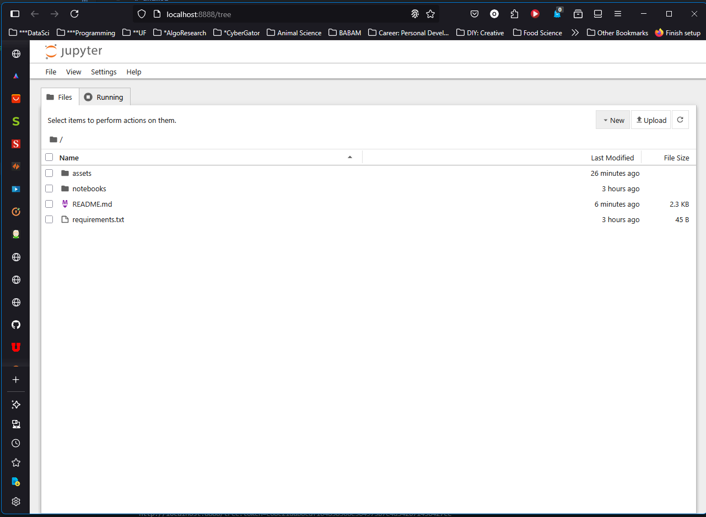

# animoz
A personal collection of mathematical, graphical, and experimental animations.

## Manim Community

Python **3.12** is the default development environment; Python **3.11.5+** is also
supported, with the latest 3.11 patch checked in CI. The Manim examples use **CMU Serif** on a light canvas
with dark text. [See uppercase, title case, lowercase, bold, and italic samples](docs/images/cmu-serif.png).

Open this branch in GitHub Codespaces, or use VS Code's **Reopen in Container**.
Once setup finishes, render your first example:

```bash
make preview
```

The terminal prints the MP4 path. Each render gets a new timestamped directory
under `media/intro/`, with a snapshot of its settings and a `run.json` record.

| Intro scene | What it demonstrates | Saved video |
| --- | --- | --- |
| `welcome` | Model, scene, and camera as separate layers | [Watch](videos/intro/welcome.mp4) |
| `motion` | An equation drives position and velocity on one clock | [Watch](videos/intro/motion.mp4) |
| `cameras` | The same motion replayed from overhead, oblique, and side views | [Watch](videos/intro/cameras.mp4) |

```bash
animoz list
animoz doctor
animoz render intro welcome
animoz render intro motion
animoz render intro cameras
animoz render intro all --quality high
```

These commands work directly in the configured container. On a local machine,
activate the installed environment or prefix them with `uv run --locked --extra manim`.

- [Setup: Codespaces, Docker, or a local environment](docs/setup.md)
- [Understand and modify the intro project](docs/intro.md)
- [Add another project without duplicating the shared code](docs/architecture.md)
- [CI, saved videos, and branch workflow](docs/development.md)
- [Dependency auditing and execution boundaries](docs/security.md)

### Project structure

| Location | Responsibility |
| --- | --- |
| `src/animoz/core/` | Units and numerical models; no Manim dependency |
| `src/animoz/runtime.toml` | Shared font and native environment prerequisites |
| `src/animoz/rendering/` | Shared clock and presentation helpers |
| `src/animoz/projects/intro/` | Intro settings, model adapter, and three scenes |
| `src/animoz/registry.py` | Register each project's scene aliases |
| `videos/intro/` | Selected finished MP4s stored with the source |
| `media/` | Separate, automatically named working renders |
| `notebooks/` | Existing notebook experiments and saved GIFs |

The [Puerta Court project](docs/puerta-court.md) adds the measured corner,
explained motion physics, selectable replay cameras, and an offline time/camera
viewer. The [systolic-array project](docs/systolic-array.md) animates the final
presentation through matrix products, operand flow, stalls, tiling, and measured
performance, on a branch containing the Puerta changes.

## Notebook requirements
- Python 3.11.5+
- numpy
- matplotlib
- FFmpeg executable on `PATH` for GIF export
- vpython

Install the notebook dependencies with:
```bash
    pip install -r requirements.txt
```

Install [FFmpeg](https://ffmpeg.org/download.html) separately for your operating system.
Check `ffmpeg -version` before running the animation export cells. GIF exports use FFmpeg.


## 📖 How to Run the Project

---

### Option 1: Using Visual Studio Code (Recommended)

1. If not already installed, download and install Visual Studio Code:   

    [https://code.visualstudio.com/](https://code.visualstudio.com/)

2. Install the **Jupyter Extension** in VSCode:
   - Open VSCode.
   - Go to Extensions (`Ctrl+Shift+X`).
   - Search for `Jupyter` and install it.


3. Open the project in Visual Studio Code:
   - From VSCode, go to `File` → `Open Folder...` and select the `animoz` project folder

4. Install project dependencies:
   - Open the VSCode integrated terminal (`Ctrl + ``), and run:
    ```bash
        pip install -r requirements.txt
    ```

   - If using a different terminal (Command Prompt, Git Bash, etc.):
    ```bash
        cd path/to/animoz
        pip install -r requirements.txt
    ```

5. Open any `.ipynb` file from the `notebooks/` folder directly in VSCode and run the cells using the built-in Jupyter extension.

---

### Option 2: Using Jupyter Notebook in the Browser

1. Install project dependencies:

```bash
    cd path/to/animoz
    pip install -r requirements.txt
```

2. Install Jupyter Notebook if not already installed:

```bash
    pip install jupyter
```

3. Start Jupyter Notebook:

```bash
    jupyter notebook
```

4. You will see an HTTP link printed in the terminal, something like:

```
    http://localhost:8888/tree?token=your-generated-token
```

5. Copy and paste this link into your browser to open the Jupyter interface     
or click the link directly if supported by your terminal (e.g., Ctrl+Click on Windows).


6. Navigate to the `notebooks` folder and open any `.ipynb` file to run the cells.

---

💡 **Note:**  
- You can also manually navigate to `http://localhost:8888` or `http://127.0.0.1:8888/`  and use the token printed in the terminal when prompted.  
- This works from any terminal: Git Bash, VSCode Terminal, Command Prompt, or PowerShell.


