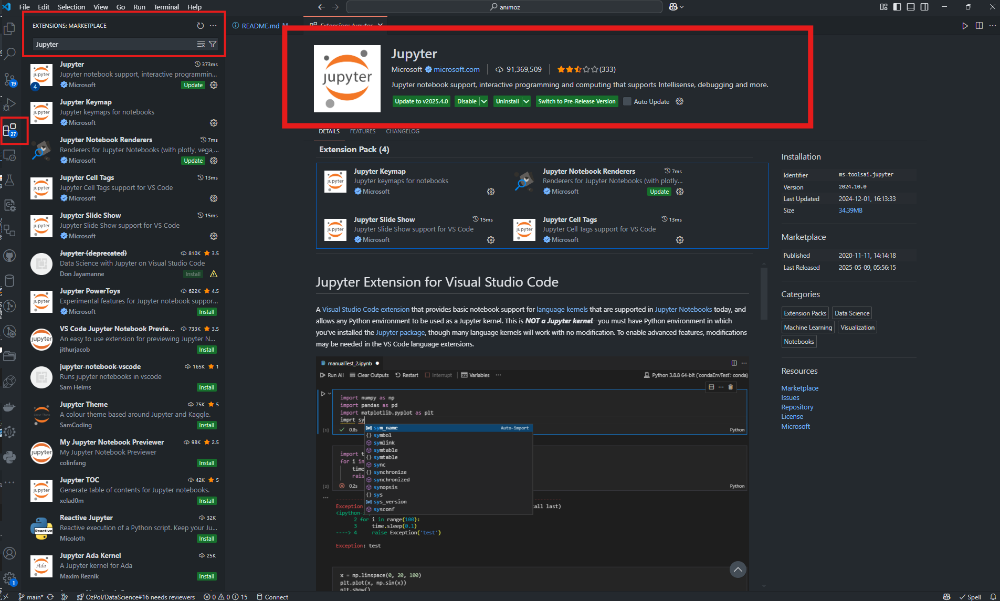
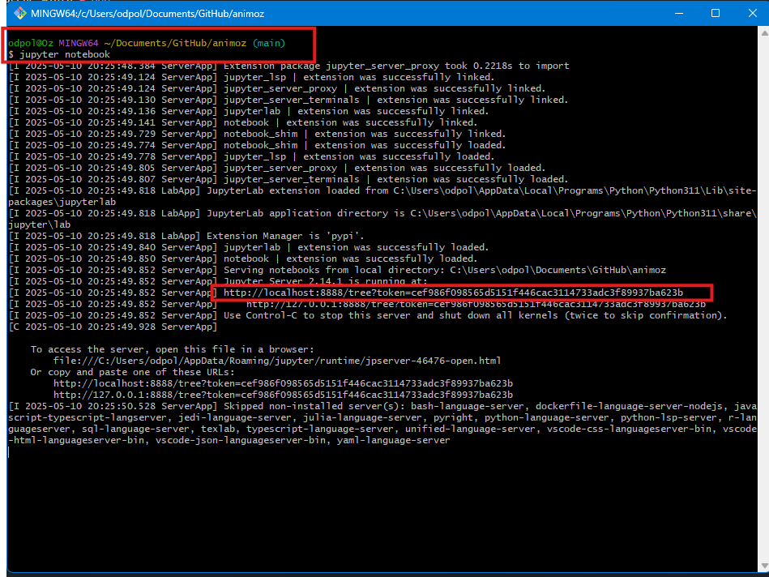

# animoz
A personal collection of mathematical, graphical, and experimental animations.


## Requirements
- Python 3.11+
- numpy
- matplotlib
- FFmpeg executable on `PATH` for GIF export
- vpython

Install all dependencies with:
```bash
    pip install -r requirements.txt
```

Install [FFmpeg](https://ffmpeg.org/download.html) separately for your operating system.
Check `ffmpeg -version` before running the animation export cells. GIF exports use FFmpeg.


## 📖 How to Run the Project

---

### Option 1: Using Visual Studio Code (Recommended)

1. If not already installed, download and install Visual Studio Code:   

    [https://code.visualstudio.com/](https://code.visualstudio.com/)

2. Install the **Jupyter Extension** in VSCode:
   - Open VSCode.
   - Go to Extensions (`Ctrl+Shift+X`).
   - Search for `Jupyter` and install it.




3. Open the project in Visual Studio Code:
   - From VSCode, go to `File` → `Open Folder...` and select the `animoz` project folder

4. Install project dependencies:
   - Open the VSCode integrated terminal (`Ctrl + ``), and run:
    ```bash
        pip install -r requirements.txt
    ```

   - If using a different terminal (Command Prompt, Git Bash, etc.):
    ```bash
        cd path/to/animoz
        pip install -r requirements.txt
    ```

5. Open any `.ipynb` file from the `notebooks/` folder directly in VSCode and run the cells using the built-in Jupyter extension.

---

### Option 2: Using Jupyter Notebook in the Browser

1. Install project dependencies:

```bash
    cd path/to/animoz
    pip install -r requirements.txt
```

2. Install Jupyter Notebook if not already installed:

```bash
    pip install jupyter
```

3. Start Jupyter Notebook:

```bash
    jupyter notebook
```

4. You will see an HTTP link printed in the terminal, something like:

```
    http://localhost:8888/tree?token=your-generated-token
```

5. Copy and paste this link into your browser to open the Jupyter interface     
or click the link directly if supported by your terminal (e.g., Ctrl+Click on Windows).



6. Navigate to the `notebooks` folder and open any `.ipynb` file to run the cells.

---

💡 **Note:**  
- You can also manually navigate to `http://localhost:8888` or `http://127.0.0.1:8888/`  and use the token printed in the terminal when prompted.  
- This works from any terminal: Git Bash, VSCode Terminal, Command Prompt, or PowerShell.

